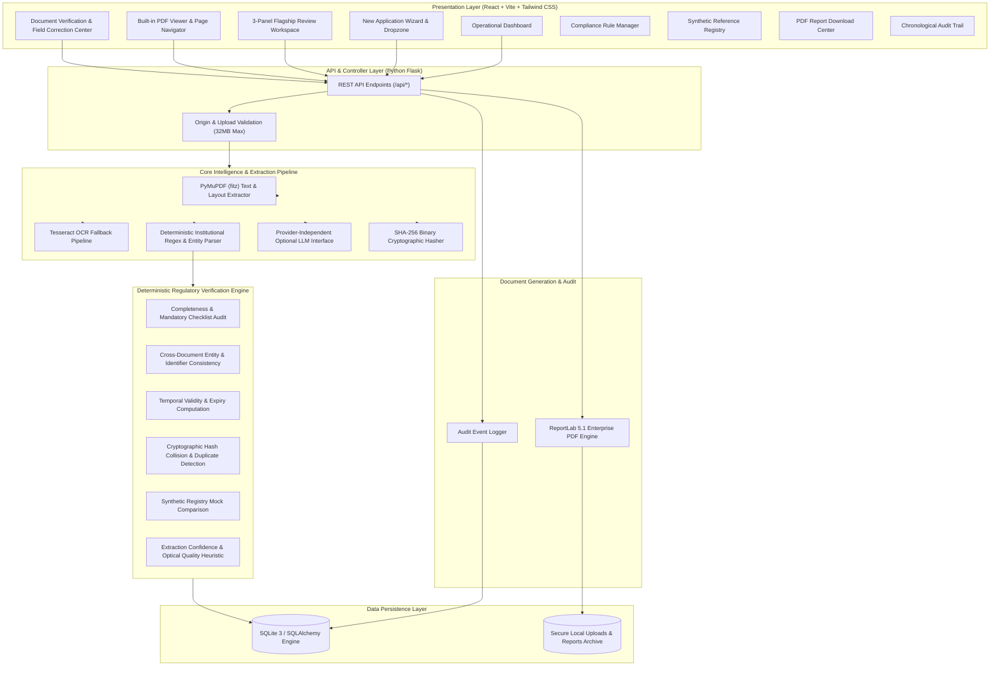

# VeriCore — System Architecture & Design Specification
**Smart India Hackathon (SIH26261)**  
*AI-Powered Application Validation, Document Authentication & Regulatory Compliance Verification Platform*  
*Tagline: Every application. Every document. Every finding, traceable.*

---

## 1. Executive Summary & Problem Context

State and national regulatory councils (such as AICTE, UGC, PCI, COA) process tens of thousands of institutional approval and affiliation dossiers annually. Each dossier contains dense, multi-page statutory documents:
- Land ownership deeds, title certificates, and revenue survey records.
- Municipal sanctioned master building plans and occupancy certificates.
- Fire & Emergency Services Safety NOCs with strict temporal validity.
- Prior approval orders and academic session affiliations.
- Society / Trust registration deeds and memoranda of association.

### Key Operational Challenges
1. **Manual Scrutiny Bottleneck:** Compliance officers manually verify hundreds of pages per institution, leading to scrutiny fatigue, delays, and human error.
2. **Cross-Document Discrepancies:** Hidden inconsistencies (such as an institution name altered in a Fire NOC, or land area mismatch between land title deeds and building plans) frequently pass unnoticed.
3. **Temporal Invalidation:** Certificates expiring right before or during the academic session are often missed.
4. **Lack of Traceable Evidence:** When applications are flagged or rejected, institutions lack line-level, page-referenced evidence explaining the rejection.
5. **Decision Support vs. Black-Box AI:** Generic AI models hallucinate approvals and cannot be legally audited. Regulatory compliance requires a **deterministic, explainable decision-support engine** with traceable page references.

---

## 2. High-Level Architectural Diagram

---

## 3. Technology Stack & Design Decisions

| Component | Technology | Rationale |
| :--- | :--- | :--- |
| **Frontend Framework** | React 19 + TypeScript | Type safety, maintainability, and enterprise-grade component architecture. |
| **Build Tool** | Vite 8 + @tailwindcss/vite | Sub-second Hot Module Replacement (HMR) and optimized minified production bundle (5s build time). |
| **Styling & Aesthetics** | Tailwind CSS v4 | Restrained government-tech design system: deep slate navy (`#0F172A`), restrained teal (`#0D9488`), and neutral slate surfaces (`#F8FAFC`). |
| **Icons & Visuals** | Lucide React | Unified icon family across navigation, severity badges, and document states. |
| **Charts** | Recharts | Clean operational trend bars and institutional category distribution charts calculated live from database records. |
| **Backend Framework** | Python 3.12 + Flask 3.1 | Lightweight, modular micro-framework with REST API blueprint structure. |
| **Database ORM** | SQLAlchemy 2.1 + SQLite 3 | Zero-configuration local persistence, relational integrity, foreign key cascading, and rapid local demo portability. |
| **PDF Extraction** | PyMuPDF (`pymupdf`) v2.0 | Ultra-fast native C-based PDF text, layout, and page-by-page bounding box coordinate parsing. |
| **OCR Fallback** | Pytesseract + Pillow (PIL) | Scanned document OCR fallback with graceful heuristic fallback when binary is absent from PATH. |
| **Report Generation** | ReportLab 5.1.0 | Enterprise-grade dynamic PDF report generation with custom `NumberedCanvas` headers, page numbering, and evidence tables. |

---

## 4. Verification Engine Check Categories

The deterministic verification engine (`verification_engine.py`) implements 6 statutory scrutiny checks:

### 1. Completeness & Mandatory Checklist (`AICTE-REQ-DOC-01`, `AICTE-FIELD-COMPL-02`)
- Verifies that all 5 mandatory statutory baseline documents are submitted:
  - `LAND_TITLE_DEED` (Land Title Deed)
  - `BUILDING_APPROVAL_PLAN` (Approved Building Plan)
  - `FIRE_SAFETY_NOC` (Fire Safety NOC)
  - `AICTE_PREVIOUS_APPROVAL` (Prior AICTE Approval / EOA)
  - `SOCIETY_TRUST_DEED` (Registered Society / Trust Deed)
- Verifies that essential structured fields (`institution_name`, `institution_code`, `certificate_number`, `issue_date`) are extracted.
- **Unambiguous Classification:** Clearly distinguishes missing documents (not uploaded) from failed verification checks.

### 2. Cross-Document Entity Consistency (`AICTE-NAME-MATCH-01`, `AICTE-PID-MATCH-02`)
- Normalizes whitespace, punctuation, and casing.
- Compares institution name extracted from every deed against application record. Flags discrepancies with exact expected vs observed values.
- Compares Permanent Institute Identifier (PID) across prior approvals and application forms.

### 3. Temporal Validity & Expiry Computation (`AICTE-FIRE-NOC-03`)
- Leniently parses diverse Indian date formats (`DD/MM/YYYY`, `DD-MM-YYYY`, `DD Month YYYY`).
- Computes validity against the commencement threshold of Academic Year 2025-2026 (01-July-2025). Flags expired certificates as `HIGH` severity.

### 4. Cryptographic Hash Collision & Duplicate Detection (`AICTE-DUP-DETECT-01`)
- Computes SHA-256 cryptographic hashes on file upload. Detects repeated binary files across submissions.
- Performs identifier frequency analysis to detect recycled certificate or sanction order numbers across distinct authorities.

### 5. Synthetic Reference Registry Comparison (`AICTE-REF-REG-01`)
- Compares submitted PID, Name, State, and Land Area against a local synthetic reference registry.
- Clearly flags matches as **synthetic demonstration comparisons**, avoiding false claims of live government verification.

### 6. Extraction Quality & Confidence Heuristic (`AICTE-EXTRACT-QUAL-01`)
- Computes layout and regex match confidence. Flags low-confidence scans (< 80%) for human reviewer confirmation without treating uncertainty as a definitive failure.

---

## 5. Security & Boundary Architecture

1. **Decision Support Boundary:** VeriCore is an AI decision-support tool. It never claims statutory authority or official government endorsement.
2. **Local Processing Guarantee:** All files, OCR, and PDF reports are processed locally on the reviewer's machine with zero cloud data leakage.
3. **Prompt Injection & Untrusted Content Defense:** Document content is treated as untrusted data; regex parsers and schema validators ensure text extracted from PDFs never overrides system prompts or executes arbitrary code.
4. **Audit Trail Accountability:** Every upload, assessment run, field correction, and finding resolution records the actor identity, timestamp, and before/after states.
